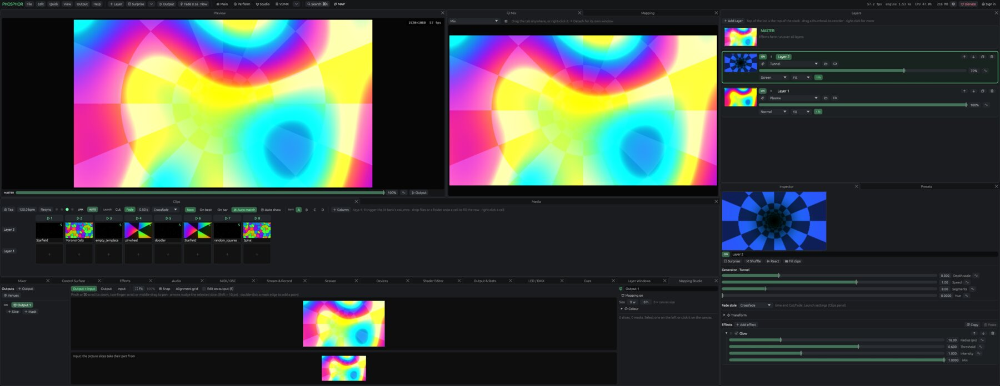

# Phosphor

Website: https://phosphorfx.com

A real-time VJ / live-visuals app: VDMX-style modular interface, MadMapper-style projection mapping and LED pixel mapping,
one engine for macOS, iPadOS/iOS and the browser. Rust + wgpu (Metal natively, WebGPU on the web) + egui.

- `crates/phosphor-engine`: platform-independent render graph, WGSL shaders, project model
- `crates/phosphor`: the app (dockable UI, output window, benchmark mode)
- `docs/VDMX-REVIEW.md`: teardown of VDMX6 Plus · `ROADMAP.md`: evaluation + TODO list



Website: [phosphorfx.com](https://phosphorfx.com/) · [free VJ software for Mac](https://phosphorfx.com/free-vj-software-mac/) ·
coming from [Resolume](https://phosphorfx.com/resolume-alternative/), [VDMX](https://phosphorfx.com/vdmx-alternative/) or
[MadMapper](https://phosphorfx.com/madmapper-alternative/) · [feature comparison](https://phosphorfx.com/compare/)

## Install

### macOS (Apple silicon)

Download `Phosphor-mac.zip` from the [latest release](https://github.com/fillinthe/phosphor/releases/latest),
unzip, drag Phosphor to Applications. **First launch:** macOS says it can't verify Phosphor (the app isn't
notarized). Click Done, open System Settings → Privacy & Security, scroll down and click **Open Anyway**; that's
once. (Terminal alternative: `xattr -dr com.apple.quarantine /Applications/Phosphor.app`.) After that Phosphor
updates itself (Help › Check for Updates…).

### Windows 10/11 (preview)

Download `Phosphor-windows.zip` from the same release, unzip anywhere and run Phosphor.exe. Windows warns once
because the app isn't signed: **More info**, **Run anyway**. Spout, NDI and Export Show work there too.

What changed in each version: [CHANGELOG.md](CHANGELOG.md).

From source:

```bash
scripts/bundle-mac.sh   # builds, signs, installs /Applications/Phosphor.app
```

## What it does

- **Play:** layers with blend modes, groups and a crossfader; a clip grid (as many columns as you like, banks for the
  keys 1–9), cut/fade/blend transitions or any effect as a transition, launch now / on the beat / on the bar, tap tempo, MIDI clock, Ableton Link,
  autopilot and trigger modes, clips that keep their own settings, movie sound, sound files as clips, cue list with timecode (MTC, LTC),
  **Match the beat** (a movie's own visual rhythm is detected and locked to the tempo), **Auto show** (the next column
  every N bars and Surprise on drops: the show runs itself).
- **Quick visuals:** Surprise (a random look on every layer), Shuffle, React to the music, Fill clips with variations,
  Instant Set — from the top bar, ⌘K, or a mapped pad. The music can be a mic, an input, session viewers' phones, or
  **the clips Phosphor itself plays** (Audio → Clip sound).
- **Effects and generators:** dozens built in (incl. a native Rutt-Etra), master effects, text layers, ISF shaders
  (325 of the 327 in the ISF collection and most MadMapper materials import: multi-pass, feedback, imported pictures,
  live `audio` / `audioFFT` inputs), a shader editor with live preview.
- **Control:** MIDI, OSC (with OSC Query and feedback), keyboard, Learn on any control; LFO / audio / step / envelope
  modulation on any value; control surfaces you build (pages, XY pads, colour); TouchOSC layout export; presets.
- **Phones:** a remote page (scan the QR code or type phosphor.local: mixer, clips, your surface, layer pictures, Auto show) and **Audience play** (a
  second code, also as a layer on the output: guests line up and take timed turns at the controls you allow).
- **Mapping:** drag corners on the projector, mesh warp, line slices, 3D models (OBJ), masks with soft edges, edge blending, per-output colour, many
  outputs each on its own screen, venue presets, Art-Net / sACN LED pixel mapping; render at 60 fps (default), 30, or the display's rate.
- **Lasers:** a Laser Designer (shapes, waves, Lissajous figures, beams, words, ILDA files, live video traced into outlines, animated and mappable) sent to Ether Dream,
  Helios, LaserCube and IDN lasers, with zones (corner-pinned areas with their own looks), dark areas, arming, a safety floor per projector, a test pattern for lining up, and Blackout.
- **AI assistants:** `Phosphor --mcp` lets AI apps that speak MCP list, set and trigger every control and see the output.
- **In and out:** hardware-decoded video (H.264/HEVC/ProRes/VP9/AV1, Hap on the GPU), cameras, capture cards, network
  streams, Syphon and NDI in and out; stream to YouTube/Twitch (RTMPS, two at once, with a recorded copy)/RTMP/SRT;
  record H.264/HEVC/ProRes/Hap; network viewers.
- **Shows:** undo, crash recovery, Export Show (a standalone app with the media), Lock Controls (play-only mode with a
  password), start at login for installations, import Resolume compositions (.avc), VDMX projects and MadMapper projects, find missing media.
- **Free and open source** (GPL). Donate, Report a Bug and Check for Updates are in the app.

## Run from source (macOS)

Needs Homebrew FFmpeg 9 for video playback: `brew install ffmpeg pkg-config`.

```bash
cargo run --release -p phosphor
```

Plays images and any common video (H.264/HEVC/ProRes/VP9/AV1 hardware-decoded, GIF, Hap, alpha
formats). The **~** button next to any slider drives it from audio (Audio panel) or an LFO. The **MASTER**
card at the top of Layers holds effects that run over the whole mix. **Mapping** adds corner-pinned
surfaces you drag into place (press **E** in the output window to edit them on the projector). **MIDI / OSC** panel: pick a
target, press Learn, move a knob (or send from TouchOSC: UDP to this Mac, port 8000). **Stream & Record**: YouTube/Twitch/RTMP/SRT
or a file, hardware-encoded, no OBS needed. **Clips**: drop media into the grid, click cells or press 1–9
to trigger columns with per-layer transitions; Tap sets the tempo, Quantize snaps triggers to the beat.
**Session**: start it, share the link — viewers watch in a browser and can send their music back
(Audio panel → "Session viewers").

Drag images onto the window or use **Open…** on a layer. Panels can be dragged by their tabs to
rearrange; **Reset Layout** restores the default. **Open Output** opens the output window; drag it
to a projector and press **F** for fullscreen.

## Benchmark

```bash
target/release/phosphor --bench 20 --gen plasma --gen rings --image media/test/testcard.png \
  --fx kaleidoscope --size 3840x2160 --snapshot /tmp/out.png
```

Prints one JSON stats line per second and a `SUMMARY` line.

## Test

```bash
cargo test   # includes WGSL validation of every shader, no GPU needed
```

## License

GPL-3.0-or-later (see `LICENSE`). Phosphor links GPL libraries (FFmpeg's GPL build, Ableton Link), so the app is GPL too:
use it, change it, share it, and share your changes under the same terms. `vendor/eframe` keeps its MIT/Apache-2.0
licence; Syphon's licence is in `vendor/Syphon-LICENSE.txt`.

Laser text uses the Hershey fonts (via the `vector-text-hershey` crate). The Hershey Fonts were originally created by
Dr. A. V. Hershey while working at the U. S. National Bureau of Standards. The format of the font data in that
distribution was originally created by James Hurt, Cognition, Inc., 900 Technology Park Drive, Billerica, MA 01821.
